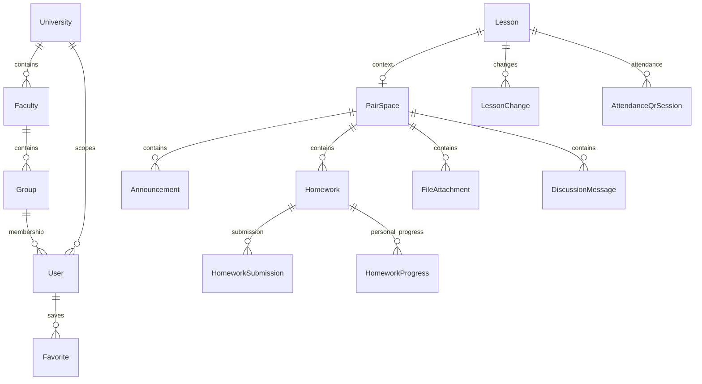

# Data model

The operational schema is defined by TypeORM entities in `apps/backend/src/**/entities/` and the ordered migrations in `apps/backend/src/migrations/`. This page is a domain overview; it is not a generated SQL schema. For exact columns, indexes and constraints, read the entity and migration together.

## Domain areas

The normalized academic model adds `Course`, `LessonSeries`, concrete `LessonOccurrence`, `CourseSpace`, `LessonSpace`, `AcademicEvent` and `ScheduleChange` records while existing `Lesson`/`PairSpace` routes remain available.

## Persistence and tenant boundaries

University ownership is represented on relevant domain records and enforced by backend tenant/resource checks. Do not assume every table has a `university_id` column, and do not assume PostgreSQL RLS is active: current migrations create no RLS policies. See [roles and permissions](roles-and-permissions.md) and the per-domain entities for exact scope.

## Schema change workflow

1. Update the TypeORM entity and add a new migration; do not edit a migration that may already have shipped.
2. Include both `up` and `down` operations and preserve tenant/foreign-key constraints.
3. Update the related [module documentation](../modules/) and [schema overview](../database/schema-overview.md).
4. Production backend executes pending migrations at startup; operators must take a backup and review logs.

The current migration inventory is `apps/backend/src/migrations/` (17 migrations as of 2026-09-29). TypeORM is the ORM; no Prisma schema exists.

## Related documents

- [Schema overview](../database/schema-overview.md)
- [Academic domain](academic-domain.md)
- [Backend architecture](backend-architecture.md)
