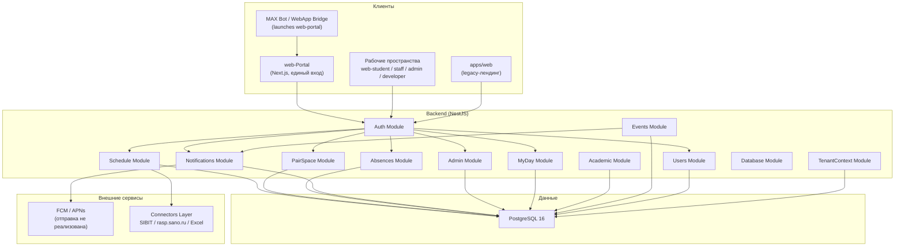
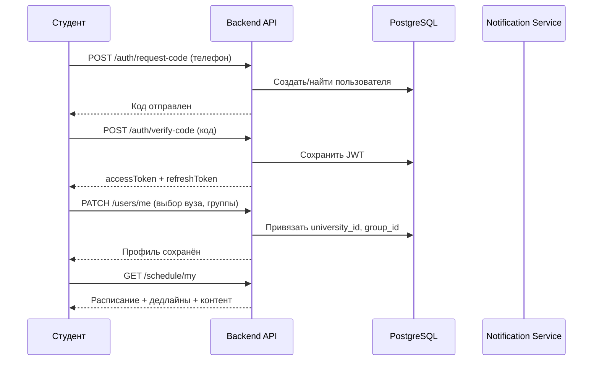
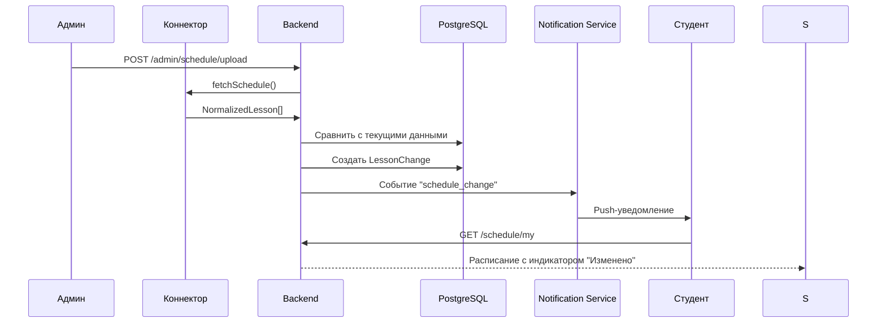

# Архитектура системы НаПаре

## Высокоуровневая схема

> **Не интегрировано в коде backend**: Redis (контейнер и `REDIS_URL` есть в Docker Compose,
> клиента в коде нет) и S3 (только переменные `STORAGE_*` в `apps/backend/.env.example`).
> Push-отправка (FCM/APNs): загружается `deviceToken` (`POST /devices/token`), сама отправка не реализована.

## Модульный монолит

Единый NestJS-процесс с модульной структурой. См. [ADR-0001](../decisions/0001-modular-monolith.md).

Каждый модуль — автономная область ответственности:

| Модуль | Ответственность | Файлы |
|--------|----------------|-------|
| Auth | Вход (login, portal-login, MAX), JWT, рефреш, каталог rasp.sano.ru | `modules/auth.md`, `apps/backend/src/auth/` |
| Users | Профиль, роли, вузы/факультеты/группы, `POST /users/me/bind-group` | `apps/backend/src/users/` |
| Schedule | Расписание, коннекторы (SIBIT, Excel), детект изменений | `modules/schedule.md`, `apps/backend/src/schedule/` |
| PairSpace | Объявления, ДЗ, файлы, обсуждение | `modules/pair-space.md`, `apps/backend/src/pair-space/` |
| Absences | Статусы отсутствий, посещаемость, подтверждения куратора | `modules/absences.md`, `apps/backend/src/absences/` |
| Notifications | In-app уведомления, inbox, device token | `modules/notifications.md`, `apps/backend/src/notifications/` |
| Admin | Управление вузом, ролями, импорт/синхронизация расписания | `modules/admin.md`, `apps/backend/src/admin/` |
| MyDay | Агрегация данных для главного экрана | `modules/my-day.md`, `apps/backend/src/my-day/` |
| Academic | Курсы, серии/занятия, академические события | `modules/academic.md`, `apps/backend/src/academic/` |
| Events | Шина событий и журнал событий (`event-bus`, `event-record`) | `apps/backend/src/events/` |
| Rasp | Доступ к rasp.sano.ru; подключается в Auth и Schedule | `apps/backend/src/rasp/rasp.module.ts` |
| Database | Инициализация схемы (`init.sql`) | `apps/backend/src/database/` |
| TenantContext | Контекст `tenant_id` / `university_id` для изоляции данных | `apps/backend/src/common/tenant/` |

Модули регистрируются в `apps/backend/src/app.module.ts` (Auth, Users, Schedule, PairSpace, Absences,
Notifications, Admin, MyDay, Database, TenantContext, Events, Academic); `RaspModule` импортируется
модулями Auth и Schedule.

## Потоки данных

### Регистрация студента

### Изменение расписания

## См. также

- [tech-stack.md](tech-stack.md) — стек технологий
- [data-model.md](data-model.md) — модель данных
- [roles-and-permissions.md](roles-and-permissions.md) — матрица прав
- [connectors.md](connectors.md) — слой коннекторов
- [decisions/](../decisions/) — архитектурные решения
