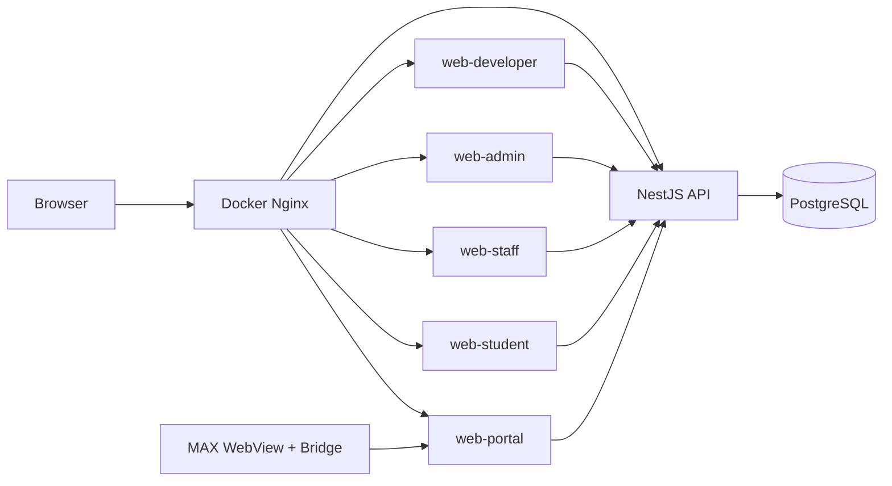

# System overview

**Current implementation reference, reviewed 2026-09-29.** The diagram shows services in the production Compose topology. It does not imply that optional providers or every route have production runtime verification.

MAX opens the existing portal. Login offers an explicit choice between MAX and university credentials. An unlinked MAX identity can be linked later from account connections after password login. See [MAX integration](../clients/max-miniapp.md).

## Backend modules

NestJS modules cover authentication, users, schedule, academic context, Pair Space, absences/QR attendance, favorites, notifications, search, administration, events, tenant context, account curatorship and platform control. They run in one backend process. Source registration is in `apps/backend/src/app.module.ts`.

Added 2026-10-16: [curatorship](../product/account-curatorship.md) uses group assignments independent of the primary role. [Platform control](../product/platform-control.md) uses owner/delegated permissions and an optional host agent over a signed Unix-socket transport; backend does not mount the Docker socket. Agent installation requires the explicit [control overlay procedure](../deployment/platform-control.md). Android uses the existing website plus a manual local plan; see [mobile clients](../clients/mobile.md). These additions are repository state, not confirmation of production installation.

## Tenant and role checks

The backend uses university context, role guards and resource checks in services/controllers. PostgreSQL RLS policies are not present in migrations. See [role boundaries](roles-and-permissions.md) and [schema overview](../database/schema-overview.md).

## Integration status

| Component | Repository state |
|---|---|
| PostgreSQL | Production and development Compose service; TypeORM entities/migrations |
| Redis | Compose service exists; backend client and queue integration are not connected |
| SIBIT schedule source | Backend connector and bounded student group schedule reads |
| Excel schedule | Admin flow exists; see current limitations in [schedule module](../modules/schedule.md) |
| Moodle | Site-info test and encrypted connector credentials; no LMS content sync |
| S3/MinIO file storage | Environment placeholders/MinIO development service; backend storage adapter is not connected |
| Push (FCM/APNs) | Device token record/endpoint exists; delivery is not implemented |
| Sentry | Backend integration initializes when `SENTRY_DSN` is set |
| PostHog, Grafana, Kubernetes | Not configured by current repository deployment |

## Runtime truth

The root `docker-compose.yml` includes `docker-compose.prod.yml`; `docker-compose.dev.yml` runs only PostgreSQL, Redis and MinIO. Production backend enables TypeORM migrations at startup. Check [DEPLOY.md](../../DEPLOY.md) for operator commands. Source/configuration checks do not prove staging or production health.

## Related documents

- [Project map](../ai/project-map.md)
- [Tech stack](tech-stack.md)
- [Data model](data-model.md)
- [Connectors](connectors.md)
- [Deployment](../../DEPLOY.md)
