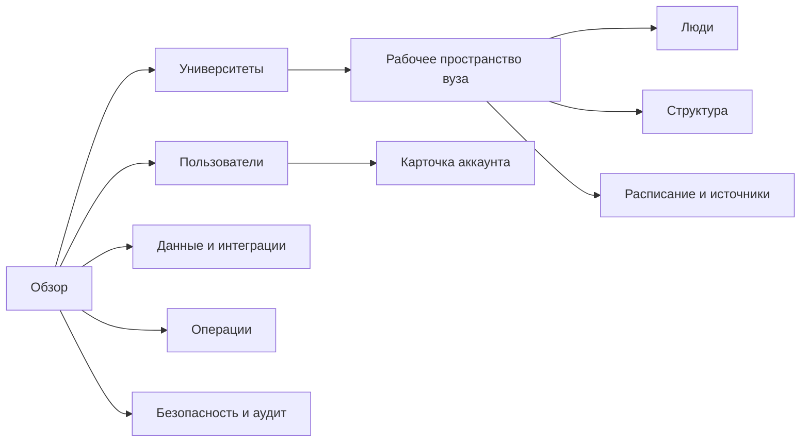

# Техническое задание: компактная панель управления платформой

**Статус:** проектное ТЗ, не реализация

**Дата:** 26 ноября 2026

**Продукт:** NaPare, кабинет `/developer/control`

**Пользователи:** владелец платформы, суперадминистратор, делегированные операторы

## 1. Проблема и цель

Сейчас кабинет группирует 26 специализированных разделов в четыре категории: «Пользователи», «Учебная среда», «Карьера», «Платформа». На главной есть переходы к аккаунтам и вузам, а ниже — большой каталог инструментов. Администратор видит внутренние области продукта и должен сам догадаться, где выполнить свою задачу.

Цель — превратить каталог функций в компактное рабочее место: человек выбирает задачу, видит нужные данные в контексте конкретного вуза или всей платформы, безопасно выполняет действие и понимает его результат.

Успех измеряется по завершённым задачам, а не количеству экранов:

- основные задачи выполняются максимум за 3 перехода после входа;
- оператор всегда понимает, к какому вузу и области доступа относится экран;
- ошибки показывают, что именно исправить и доступно ли действие этой роли;
- каждое изменение чувствительных данных объяснимо в журнале;
- рабочая область не превращается в постоянный список из десятков равноправных инструментов.

## 2. Границы и фактическая база

ТЗ описывает целевое поведение. Оно не утверждает, что предлагаемые функции уже реализованы.

| Область | Подтверждённое текущее поведение | Целевое поведение |
|---|---|---|
| Основная навигация | 4 категории и 26 специализированных пунктов | 6 понятных рабочих областей и контекстные инструменты |
| Аккаунты | Поиск, создание, изменение, блокировка, архив и восстановление | Единый каталог и карточка с ясными действиями, связями и историей |
| Архив аккаунта | Обратим, вход закрывается, учебная история сохраняется; удаление требует причину | Сохранить существующий жизненный цикл, добавить понятный просмотр последствий и восстановление |
| Вузы | Список, создание с первым аккаунтом `university_admin`, изменение названия/города/статуса; структура факультетов и групп архивируется | Рабочее пространство вуза с людьми, структурой, расписанием, источниками, статусом и журналом |
| Архив вуза | В панели не реализован | Спроектировать отдельно; не подменять текущим статусом и не удалять данные |
| Расписание | Текущая интеграция содержит специальные условия для СИБИТ | Настраиваемые подключения с проверкой и предварительным просмотром импорта; универсальность подтверждать отдельно для каждого адаптера |
| Права | Гранты, область вузов и серверная проверка существуют | Сделать область и ограничения видимыми в интерфейсе; не ослаблять серверную авторизацию |

## 3. Роли и модель доступа

- **Владелец платформы** управляет платформой, назначает и отзывает делегированные разрешения, видит «Контур доверия» и может выполнить предусмотренный системой экстренный отзыв.
- **Суперадминистратор** управляет платформенными задачами в пределах правил текущей роли. Он не становится владельцем и не получает операции владельца автоматически.
- **Делегированный оператор** видит только выданные разделы, действия и область вузов. Грант на один вуз не даёт доступ к другому вузу.
- **Администратор вуза** работает только с назначенной организацией в её личном кабинете. Он не получает глобальные настройки и данные других вузов.

Обязательные инварианты:

1. Backend проверяет право и область при чтении списка, открытии записи по ID и каждой мутации. Скрытая кнопка не является контролем доступа.
2. Контекст организации показывается в заголовке и карточке объекта. Для глобального оператора явно показывается «Вся платформа».
3. Самого себя, владельца и аккаунты более высокого уровня нельзя менять в обход существующих серверных ограничений.
4. Доступ к учебным, личным, кадровым данным и сообщениям требует соответствующего доменного разрешения; право `accounts.read` его не подразумевает.
5. Передача владения, произвольные SQL-запросы и произвольный терминал не добавляются в эту панель.

## 4. Информационная архитектура

Главное меню содержит не более шести рабочих областей. Не доступные по гранту пункты скрыты, но активная область доступа остаётся видимой.

| Раздел | Для чего нужен |
|---|---|
| **Обзор** | Состояние платформы и список требующих внимания задач |
| **Университеты** | Каталог организаций и выбранное рабочее пространство вуза |
| **Пользователи** | Поиск людей, карточки, роли, доступ и жизненный цикл аккаунта |
| **Данные и интеграции** | Источники данных, подключение и ход синхронизаций |
| **Операции** | Здоровье сервисов и разрешённые эксплуатационные действия |
| **Безопасность и аудит** | Гранты, журнал изменений и доступный владельцу контур доверия |

Редкие инструменты по учебным данным и карьере остаются доступны по праву: из контекста вуза, карточки пользователя, результатов глобального поиска или через «Дополнительные инструменты». Они не занимают первый уровень меню. Прямые ссылки и параметры вкладки продолжают открывать соответствующие разрешённые инструменты.

Технические страницы разработчика (мониторинг, сессии, системные события, справка/API) не смешиваются с ежедневными задачами управления вузами и пользователями. Они остаются в отдельной рабочей области; общий стиль и глобальный поиск могут быть общими, если права и контексты не смешиваются.

В шапке: глобальный поиск, текущая область доступа, уведомления о сбоях и меню аккаунта. «Найти» ищет разделы и записи только в доступной области. Клавиатурное сокращение / командная палитра — необязательное удобство после основного поиска.

## 5. Экран «Обзор»

Первый экран отвечает на три вопроса: «Всё ли работает?», «Что требует моего решения?», «С чего начать?».

Сверху вниз:

1. **Рабочий контекст:** роль, область доступа, выбранный период; у ограниченного оператора — разрешённые организации.
2. **Требуют внимания:** только фактические ошибки и ожидающие действия с причиной, датой и прямым переходом к решению. Не показывать вымышленные показатели.
3. **Университеты:** активные/ожидающие подключения и короткая сводка синхронизации, если доступна.
4. **Недавние изменения:** последние действия в доступной области с автором, объектом, причиной и результатом.
5. **Частые действия:** «Добавить вуз», «Найти пользователя», «Настроить источник» — отображать только если действие разрешено.

При пустой базе показывать следующий шаг настройки. При ошибке загрузки сохранять доступные секции и давать повторить загрузку конкретного блока. Нулевое значение не называть проблемой, если для него нет правила продукта.

## 6. Каталог вузов и рабочее пространство организации

### Каталог

Таблица или компактный список с поиском и фильтрами. Для каждой записи показывать: название и город, статус, подключённый источник/его состояние, последнее успешное обновление, число пользователей и групп (если право разрешает), доступных администраторов, краткое предупреждение. Одноимённые организации различать городом и коротким ID.

Основное действие — открыть вуз. Вторичные — создать, изменить доступные реквизиты, открыть журнал. Состояния «ожидает подключения», «не подключён», «синхронизация с ошибкой» должны иметь текстовое объяснение.

### Создание вуза

Форма создания запрашивает название и город вуза, логин и пароль первого администратора. Новому аккаунту автоматически назначаются роль `university_admin` и область доступа только к созданному вузу; имя, фамилия и email не спрашиваются. Вуз и аккаунт создаются атомарно. Пароль передаётся только при создании, хешируется сервером, не возвращается API и не записывается в аудит.

Учебная структура может быть пустой. Источник данных настраивается отдельно после создания; импорт не начинается автоматически.

До сохранения система проверяет похожие названия и показывает возможный дубликат. Не объединять организации автоматически. Не обещать импорт до теста соединения.

### Страница вуза

Постоянная шапка: название, город, статус, короткий ID, доступ оператора и кнопка «Изменить сведения». Вкладки:

- **Обзор:** счётчики структуры и аккаунтов, статус данных, последние ошибки и действия.
- **Люди:** администраторы, преподаватели, кураторы и студенты; поиск и фильтры по роли/статусу/группе.
- **Структура:** факультеты и группы, поиск, добавление, архив/восстановление с причиной.
- **Расписание и источники:** подключение, тест, предварительный просмотр и история синхронизаций.
- **Настройки:** только реальные настройки организации и поддерживаемых функций.
- **Журнал:** действия над этим вузом с переходом к объекту.

Архивирование университета — отдельная будущая функция. До проектирования должны быть определены последствия для входа, интеграций, связанных аккаунтов, учебной истории и восстановления. Не использовать неактивный статус как скрытый архив и не выполнять физическое удаление.

## 7. Пользователи и аккаунты

### Каталог пользователей

Единый поиск по логину, email, имени, фамилии, телефону, вузу, группе и UUID в пределах разрешённой области. Результаты с одинаковыми именами различать вузом, группой и коротким ID. Фильтры: роль, вуз, статус входа, активный/архивный, наличие группы. Таблица поддерживает сортировку, страницы, сохранение фильтров в URL и понятное пустое состояние.

### Карточка пользователя

Содержит: имя и логин; контактные данные в соответствии с правами; основную роль; статус входа; вуз и группу; кураторские назначения; связанные внешние подключения только как факт/статус; даты создания/изменения; недавний аудит. Учебные или личные записи не раскрываются через карточку аккаунта без отдельного права.

Действия сгруппированы по задаче:

- **Профиль:** имя, логин и контактные поля.
- **Доступ:** основная роль, организация и группа с проверкой совместимости.
- **Вход:** блокировка/разблокировка, сброс учётных данных штатным безопасным сценарием, завершение сессий.
- **Жизненный цикл:** архив и восстановление с причиной.
- **История:** аудит изменений и переходы к отдельным разрешённым доменным операциям.

Пароль никогда не показывается и не записывается в аудит. Если создание пока требует временный пароль, интерфейс обязан явно обозначить временность и следующий шаг замены. Целевой предпочтительный сценарий — приглашение/одноразовая установка секрета при наличии подтверждённого канала доставки.

Архив аккаунта блокирует вход и скрывает его из активного списка, сохраняет учебные связи и допускает восстановление с причиной. Восстановление сохраняет прежнее состояние входа: ранее заблокированный аккаунт остаётся заблокированным. Окончательное стирание не является действием суперадминистратора в этой карточке.

## 8. Данные и интеграции расписания

Настройка источника выполняется из рабочего пространства вуза:

1. Выбрать поддерживаемый коннектор и указать только необходимые параметры.
2. Секретные параметры вводятся в защищённые поля; после сохранения отображаются только как «настроено/не настроено».
3. Запустить «Проверить подключение» без изменения данных.
4. Показать найденные учебные периоды, факультеты, группы, преподавателей, аудитории и занятия; явно обозначить непривязанные и конфликтующие записи.
5. Выполнить предварительный расчёт: сколько объектов будет создано, обновлено, пропущено или требует решения.
6. Только после просмотра результата разрешить импорт/синхронизацию.
7. Показать этапы выполнения, время, итоговый отчёт и ошибки с понятной причиной и повторным запуском.

Требования к импорту: tenant-scoped; повторный запуск идемпотентен; существующие ручные поля и архивные объекты обрабатываются по явным правилам; ошибки частичного запуска видимы; есть история источника и синхронизаций. Настройки источника, владелец данных, направление синхронизации и разрешение конфликтов определяются для каждого типа коннектора. Если коннектор поддерживается только для СИБИТ, интерфейс должен явно это сказать.

## 9. Массовые и чувствительные операции

- Массовое действие доступно только для однородного набора записей и при наличии серверного разрешения для каждой записи.
- Перед применением показывать область, число объектов, перечень последствий и число пропусков/ошибок.
- Для блокировки, архивирования, смены роли/вуза и изменения данных требовать подтверждение и причину согласно политике домена.
- Архивирование обратимо; для обратимой операции показывать способ восстановления.
- Не обещать универсальную кнопку «Отменить», если действие уже вызвало необратимые побочные эффекты. Вместо этого — точная процедура восстановления.
- Не добавлять физическое удаление как массовое действие.

## 10. Безопасность, журнал и эксплуатация

Журнал должен позволять фильтровать по периоду, оператору, вузу, типу действия и объекту. Событие содержит автора, время, область, объект, действие, причину, итог и безопасные старое/новое значения. Секреты, пароли, токены и внешние идентификаторы не попадают в выдачу. Технические ID можно копировать отдельно, не выставляя их главным содержимым.

Операции сервисов остаются allowlist-действиями (доступный restart/rebuild) с проверкой гранта, подтверждением, состоянием выполнения и результатом. Панель не предоставляет shell/SQL. Сбой host-агента не должен блокировать управление аккаунтами и вузами; операция в таком случае явно завершается ошибкой.

«Контур доверия» виден только владельцу. Гранты показывают субъекта, область вузов и разрешения до сохранения; пустая область означает отсутствие доступа, а глобальная область подписана явно. Экстренный отзыв требует предусмотренного повторного подтверждения и не маскируется под обычную кнопку сброса.

## 11. UX и визуальные требования

- Компактный интерфейс без больших декоративных карточек: сначала таблица/рабочие данные, потом сводки и подсказки.
- Одна главная задача на экран; максимум одна основная кнопка и несколько контекстных вторичных действий.
- Стабильный верхний контекст: раздел → вуз → объект. Хлебные крошки возвращают на ожидаемый уровень.
- Русские названия действий и ролей; сокращение или технический термин раскрываются при первом появлении.
- В таблицах важные идентификаторы и организация не обрезаются без доступного полного значения; длинные списки имеют пагинацию, фильтры и запоминание контекста.
- Для каждого запроса: загрузка, пустой результат, ошибка с повтором, успешное сохранение и состояние отсутствия прав.
- Ошибка валидации привязана к полю; наверху формы показывается краткое объяснение. После ответа API значения не сбрасываются.
- Доступность: клавиатурная навигация, видимый фокус, подписи полей, семантические таблицы/заголовки, контраст, экранные дикторы, touch-target для узкого экрана, reduced motion.
- Адаптивность: desktop — плотные списки; tablet — сохраняются ключевые колонки и доступ к фильтрам; mobile — карточный список и отдельная панель фильтров без горизонтального сдвига всей страницы.

## 12. Основные сценарии приёмки

1. **Найти пользователя:** оператор ищет по логину, различает одинаковые имена по вузу и группе, открывает карточку за 1–2 перехода.
2. **Создать аккаунт преподавателя в вузе:** из выбранного вуза создаёт/приглашает аккаунт, назначает преподавательскую роль и вуз, видит подтверждение и запись в аудите.
3. **Настроить расписание:** проходит проверку, видит предварительный список групп/преподавателей/аудиторий, подтверждает запуск и получает отчёт импорта.
4. **Архивировать и восстановить аккаунт:** причина обязательна, вход прекращается, история сохраняется, восстановление возвращает доступ только при прежнем разрешённом статусе.
5. **Исправить отказ входа:** из карточки доступны статус и безопасный сброс; секреты не раскрываются; причина не записывается как пароль.
6. **Редактировать учебную структуру:** группа привязана к факультету и тому же вузу; архивные элементы не назначаются новым пользователям; восстановление объясняет ограничения родительского объекта.
7. **Оператор с ограниченной областью:** список, поиск, детали, экспорт и мутация не раскрывают другой вуз; прямой URL с чужим ID отклоняется сервером.
8. **Нет доступа к действию:** экран объясняет, что функция закрыта разрешением, не предлагает неработающую кнопку и не делает вывод, что данные отсутствуют.
9. **Сбой источника/агента:** показывается реальная ошибка, доступна безопасная повторная попытка, остальные рабочие разделы продолжают открываться.
10. **Аудит:** чувствительное изменение содержит оператора, причину и старое/новое значение; пароль, токен и приватный внешний ID отсутствуют.

## 13. Нефункциональные критерии

- Сохранить существующие URL и API там, где это возможно; переход на новую IA не должен ломать ссылки с `?tab=`.
- Все проверки гранта и tenant scope остаются на сервере; новые endpoint и DTO строго валидируются.
- Списки постраничные и фильтруются сервером; поиск не загружает всю платформенную базу в браузер.
- Чувствительные действия и аудит атомарны там, где это требует доменная операция.
- Повторные запросы импорта и массовых операций защищены от дублей.
- Производительность списка: первая страница доступна до 2 секунд при 10 тыс. синтетических аккаунтов на целевой тестовой среде; поиск с фильтром — до 1 секунды. Это целевые пороги для измерения, а не текущая гарантия.
- Рабочие сценарии доступны с клавиатуры и на ширине 360 px; основные таблицы не теряют контекст организации.

## 14. Приоритет внедрения

**P0 — ясность:** новый обзор; сокращённое главное меню; глобальный поиск; контекст вуза/области; человекочитаемые ошибки; сохранение прямых ссылок. Не менять серверные права.

**P1 — работа с организациями и людьми:** workspace вуза; единый список пользователей; упрощённые карточки; понятные архив/восстановление; приглашение преподавателя, если для канала приглашения определён контракт.

**P2 — подключение данных:** настройка поддерживаемого расписания, test connection, preview/dry run, отчёт импорта, конфликт/ошибки. Отдельно подтвердить, какие источники и сущности реально поддерживаются.

**P3 — зрелая эксплуатация:** безопасные массовые операции, улучшенные фильтры аудита, диагностика, метрики фактического завершения админских задач. Экспорт — только с явным правом, ограничением объёма и аудитом.

## 15. Что не входит в этот объём и открытые решения

- Не выполнять удаление вузов или аккаунтов из production и не подменять обсуждение изменением базы.
- Не обещать подключение произвольного сайта расписаний без разработанного и проверенного коннектора.
- Не проектировать передачу владения, редактирование таблиц БД, произвольные команды или доступ к секретам.
- До P1 нужно определить способ приглашения аккаунтов преподавателей и подтверждённый контактный канал.
- До P2 владелец интеграции должен определить, какие поля являются мастер-данными при конфликте расписания с ручной правкой.
- Архив вуза требует отдельного решения по учётным записям, интеграциям, учебной истории, входу пользователей и восстановлению.
- Дубли с одинаковым названием нельзя автоматически сливать: решение принимается по ID, городу, владельцу данных и истории синхронизаций.

## 16. Источники и проверка требований

Фактическую основу составляют `apps/web-developer/src/app/(developer)/control/page.tsx`, `AccountsPanel.tsx`, `UniversitiesPanel.tsx`, `docs/product/platform-control.md`, `docs/DEVELOPER_GUIDE.md`, `docs/ui/flows.md` и текущие серверные проверки платформенных полномочий. При реализации контрактом остаются исходный код, DTO и API; этот документ задаёт целевое поведение и не заменяет security review.

**Готовность ТЗ:** требования и сценарии сформированы. **Текущее внедрение:** в рабочей ветке собраны компактный стартовый экран, быстрые задачи, поиск аккаунтов и вузов через существующие permission-scoped API, каталог→workspace вуза, фильтр аккаунтов по выбранному вузу, безопасная настройка/проверка источника расписания и человекочитаемые события аудита. Создание вуза должно атомарно создавать первый аккаунт `university_admin` с отдельными логином и паролем и привязкой к этому вузу. Поиск факультетов и групп остаётся внутри выбранного вуза, где сервер проверяет tenant scope. Это не весь объём ТЗ и ещё не production-релиз. Предпросмотр и запуск импорта из платформенной панели, универсальные новые адаптеры, архив вуза и массовые операции остаются отдельными задачами. Для выпуска каждого этапа нужны проверки backend tenant/role access, UI states, клавиатуры, адаптивности и регрессии прямых ссылок; production-проверка указывается отдельно от локальной.
